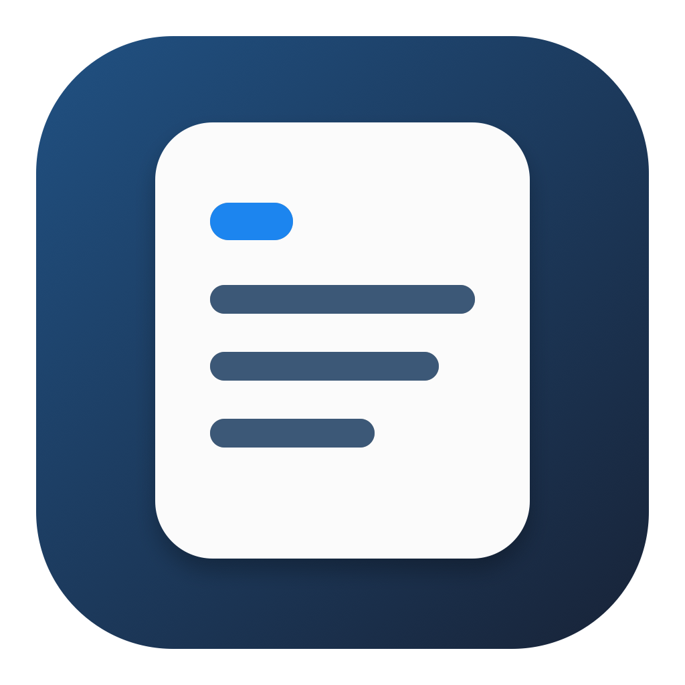

# Quick Notes

Quick Notes is a small note window for macOS. Open it from the menu bar or with a keyboard shortcut, write what you need, and get back to work. The app saves your notes automatically on your Mac.

## What it does

- Write with headings, lists, highlights, and images.
- Pin the window when you want to keep it open.
- Search your notes and reopen recent ones.
- Choose a shortcut, adjust the appearance, and set the app to launch when you log in.

## Install

Download the [v2.0 DMG](https://github.com/vladmax01-cyber/QuickNotes/releases/tag/v2.0), open it, and drag **Quick Notes.app** to Applications. This build is for Apple Silicon Macs running macOS 14 or later. You do not need Xcode to install it.

The app is signed locally but has not been notarized by Apple. macOS may ask you to approve opening it in **System Settings → Privacy & Security**.

## Build from source

The project uses Swift tools version 5.10 and targets macOS 14 or later. Xcode provides a compatible Swift toolchain. Run `bash Scripts/build_app.sh` from the repository root to build and validate a DMG in the project's `outputs` folder.

## Your notes

Notes are saved locally in `~/Library/Application Support/Quick Notes/notes.json`. This repository contains the source code and tests, not your personal notes.

## Contributors

- [@vladmax01-cyber](https://github.com/vladmax01-cyber): created and directed the project.
- **Codex (OpenAI):** helped with implementation, debugging, and documentation.
