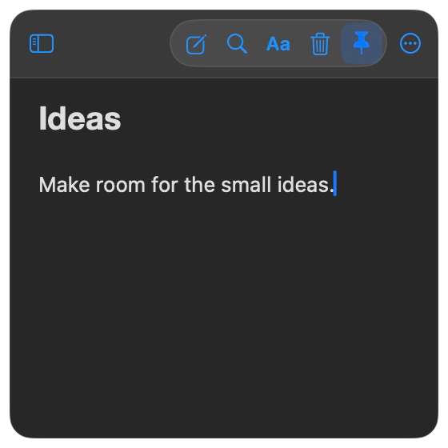
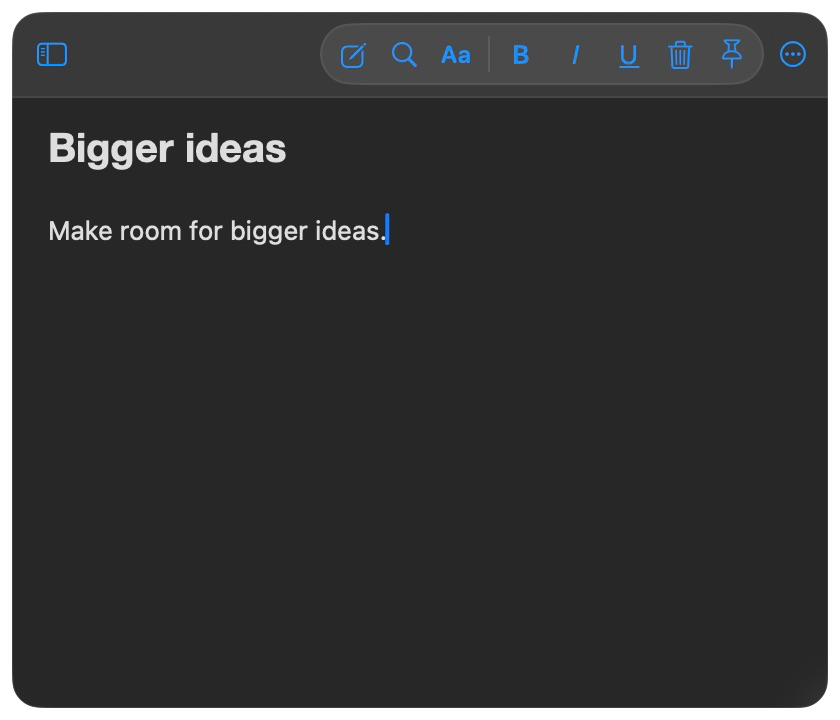
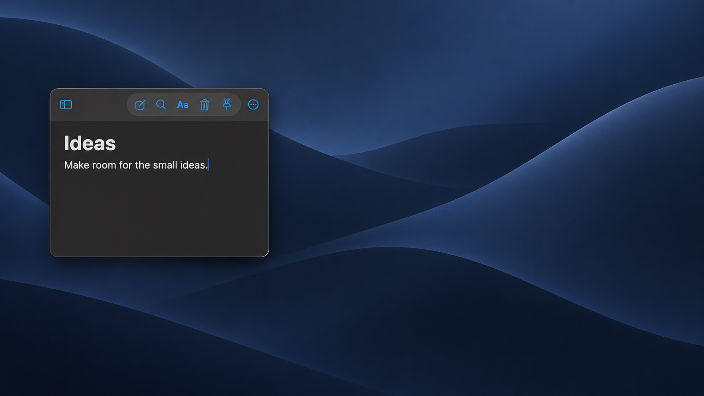
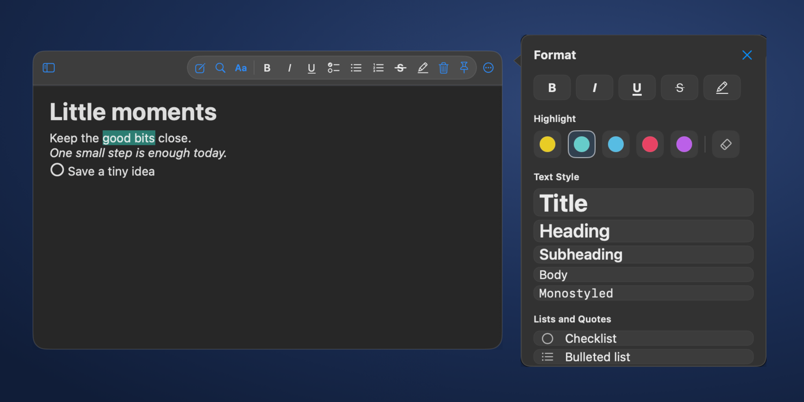
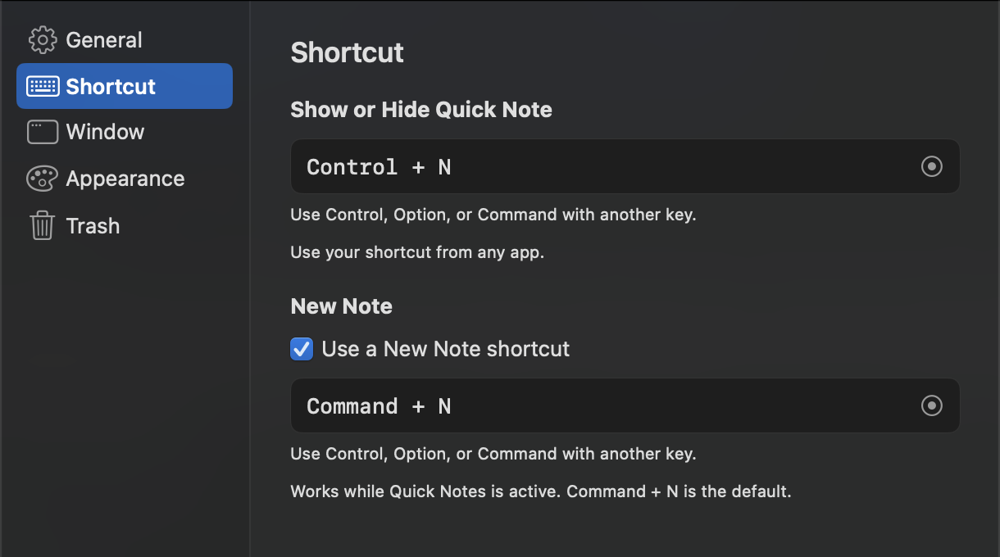
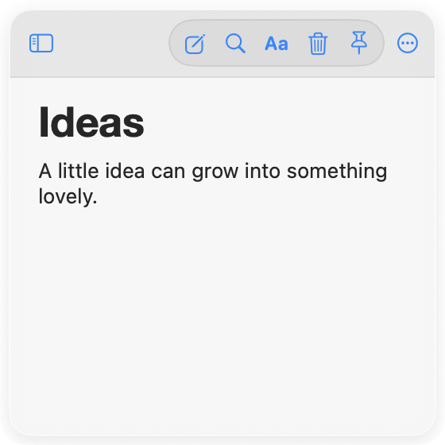
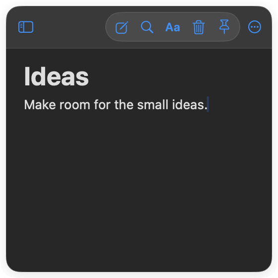

# Quick Notes

Quick Notes keeps a note close while you work. Open the floating window from the menu bar or with your own keyboard shortcut, write something down, then hide it and carry on. Your notes save automatically on your Mac.

  
  

*Two examples of the same window. Resize it freely, from a compact note to a roomy writing space that fits your screen.*

## On your desktop

*A privacy-safe desktop preview based on a real Quick Notes capture. The background is illustrative and contains no personal desktop content.*

## What it does

- Bring the note forward from any app with a configurable shortcut or the menu bar. The floating window can appear across Spaces and over full-screen apps.
- Move it where you want and resize it to suit your workspace. Quick Notes can remember its position and size, and you can pin it when it needs to stay visible.
- Double-click the header to fold the note into a small floating bar. Double-click the bar to open it again.
- Write with headings, lists, highlights, and images. Find older notes with search or the recent notes list.
- Drag an image out of a note or copy it as a PNG. Restore deleted notes from Recently Deleted in Settings, or empty the trash when you are ready.
- Turn the New Note shortcut on or off and choose its key combination in Settings.
- Follow your Mac's appearance automatically, or choose Light or Dark in Settings. Pick an accent you like. Short, restrained transitions accompany opening and collapsing the window, and the app respects Reduce Motion.

*Use the Aa menu for text styles, highlighting, lists, alignment, and font size. This sample shows a title, mint highlight, checklist, and italic text.*

*Double-click the header to tuck the note away; double-click the bar to bring it back.*

*Set either key combination in Settings → Shortcut. You can also turn off the New Note shortcut.*

## Light and dark

  
  

*The same note in both appearances. Quick Notes can follow your Mac automatically, or you can select Light or Dark in Settings → Appearance.*

## Install

Download the [v2.1.1 DMG](https://github.com/vladmax01-cyber/QuickNotes/releases/tag/v2.1.1), open it, and drag **Quick Notes.app** to Applications. This build is for Apple Silicon Macs running macOS 14 or later. You do not need Xcode to install it.

The app is signed locally but has not been notarized by Apple. macOS may ask you to approve opening it in **System Settings → Privacy & Security**.

## Build from source

The project uses Swift tools version 5.10 and targets macOS 14 or later. Xcode provides a compatible Swift toolchain. Run `bash Scripts/build_app.sh` from the repository root to build and validate a DMG in the project's `outputs` folder.

## Your notes

Notes are saved locally in `~/Library/Application Support/Quick Notes/notes.json`. This repository contains the source code and tests, not your personal notes.

## Contributors

- [@vladmax01-cyber](https://github.com/vladmax01-cyber): created and directed the project.
- **Codex (OpenAI):** helped with implementation, debugging, and documentation.
