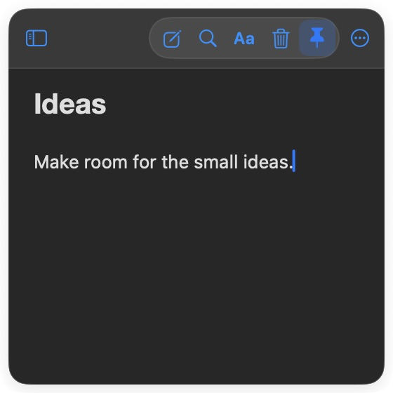
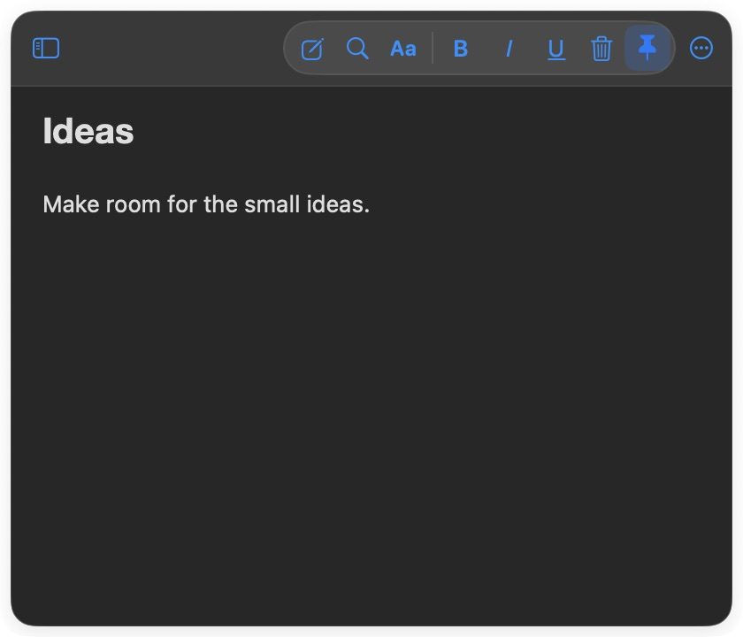
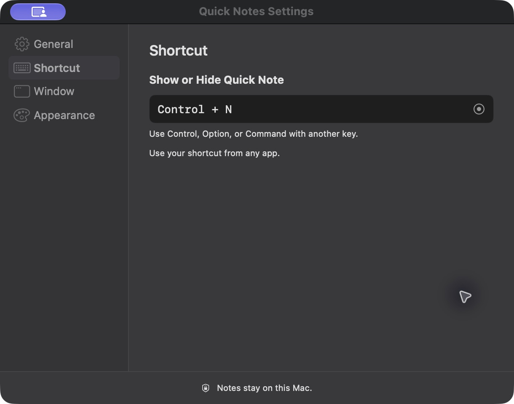

# Quick Notes

Quick Notes keeps a note close while you work. Open the floating window from the menu bar or with your own keyboard shortcut, write something down, then hide it and carry on. Your notes save automatically on your Mac.

  
  

*The actual app at two sizes, using a sample note. No personal desktop or notes are shown.*

## What it does

- Bring the note forward from any app with a configurable shortcut or the menu bar. The floating window can appear across Spaces and over full-screen apps.
- Move and resize it to fit your work. Quick Notes can remember its position and size, and you can pin it when it needs to stay visible.
- Double-click the header to fold the note into a small floating bar. Double-click the bar to open it again.
- Write with headings, lists, highlights, and images. Find older notes with search or the recent notes list.
- Choose the appearance and accent you like. Short, restrained transitions accompany opening and collapsing the window, and the app respects Reduce Motion.

*Double-click the header to tuck the note away; double-click the bar to bring it back.*

*Set the shortcut in Settings → Shortcut. The example above uses Control + N.*

## Install

Download the [v2.0.1 DMG](https://github.com/vladmax01-cyber/QuickNotes/releases/tag/v2.0.1), open it, and drag **Quick Notes.app** to Applications. This build is for Apple Silicon Macs running macOS 14 or later. You do not need Xcode to install it.

The app is signed locally but has not been notarized by Apple. macOS may ask you to approve opening it in **System Settings → Privacy & Security**.

## Build from source

The project uses Swift tools version 5.10 and targets macOS 14 or later. Xcode provides a compatible Swift toolchain. Run `bash Scripts/build_app.sh` from the repository root to build and validate a DMG in the project's `outputs` folder.

## Your notes

Notes are saved locally in `~/Library/Application Support/Quick Notes/notes.json`. This repository contains the source code and tests, not your personal notes.

## Contributors

- [@vladmax01-cyber](https://github.com/vladmax01-cyber): created and directed the project.
- **Codex (OpenAI):** helped with implementation, debugging, and documentation.
